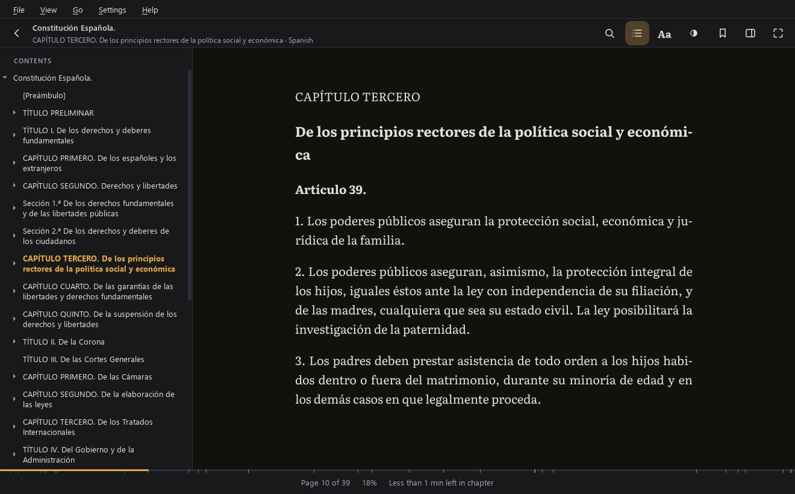
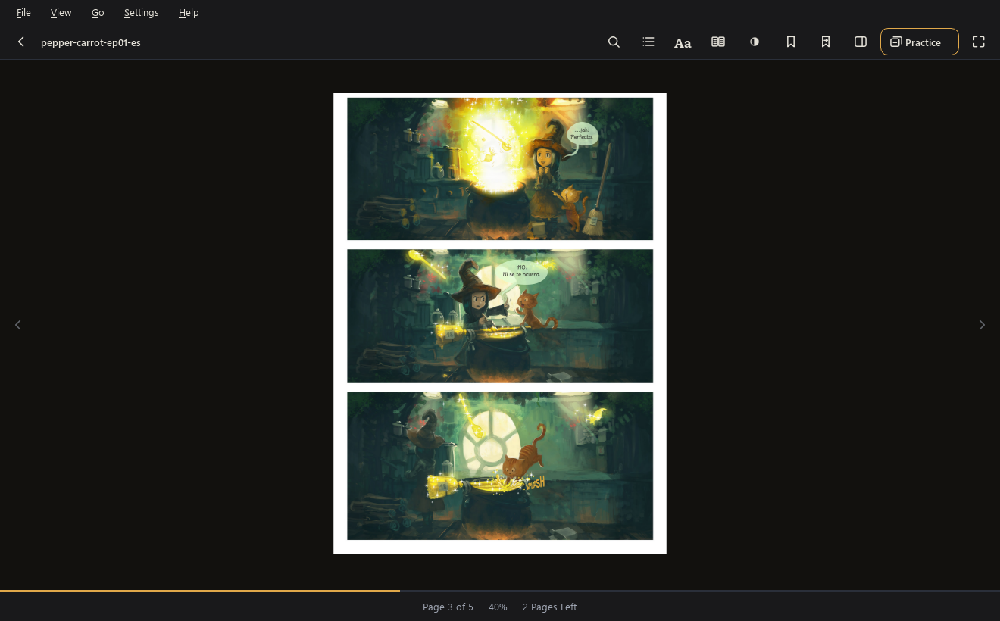
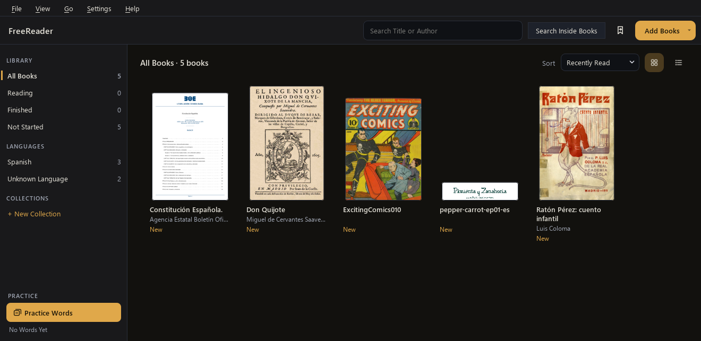
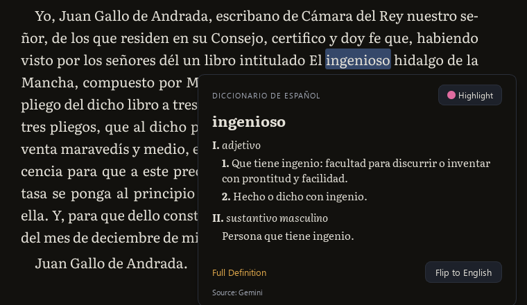
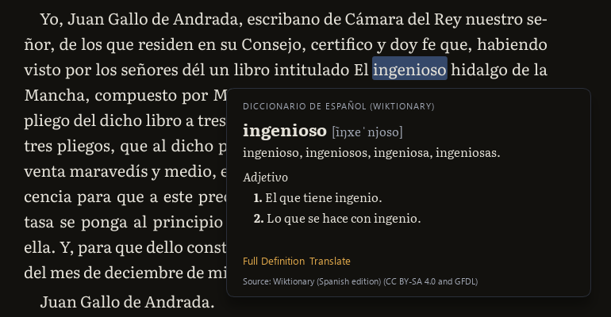
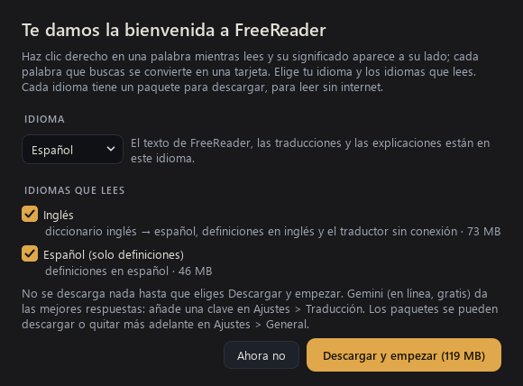
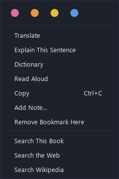
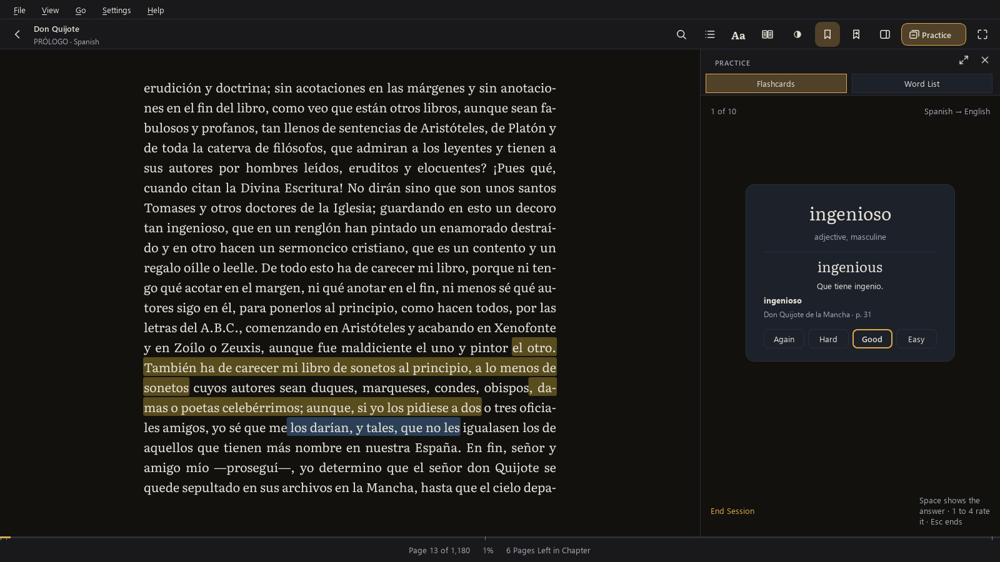
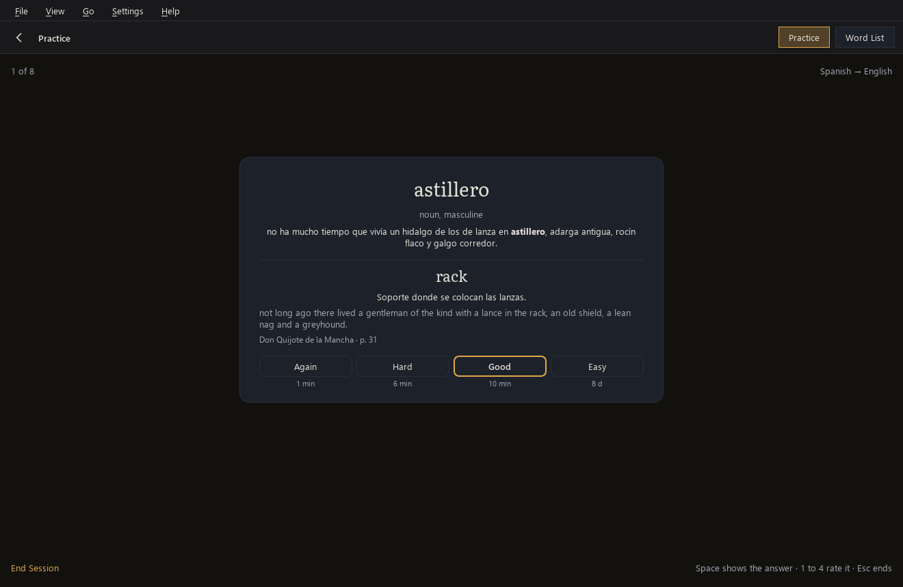

# FreeReader

An e-book reader for DRM-free books (EPUB, PDF, Kindle, FB2, comics, documents and more), for Windows (tested) and Linux (experimental), built to make reading in
another language easy: right-click a word or a passage and its English meaning appears next to it. Every word you
look up or highlight is saved, ready to practise as flashcards.


**Status:** early development (phase 4 of 7). The library, reading, themes, text settings, translation, the word
log, flashcard practice, highlights, notes, bookmarks and search work, in many book formats, PDF included. A
phone app (Android) with the same reader is being built; it isn't released yet.

## Download

Get the latest version from the [Releases](https://github.com/cincottash/FreeReader/releases) page.

| System | File | Status |
| --- | --- | --- |
| Windows 10 and 11 | `FreeReader.exe` (one file, nothing to install) | Tested |
| Linux | `FreeReader-x86_64.AppImage` | Experimental |

## Book formats

| Kind | Files |
| --- | --- |
| E-books | EPUB (2 and 3), KEPUB, FB2 (also `.fb2.zip`, `.fbz`) |
| PDF and other fixed pages | PDF, XPS and OXPS, DjVu |
| Kindle (without DRM) | MOBI, AZW, AZW3 (KF8), PRC, Palm PDB |
| Comics, manga, graphic novels | CBZ, CBR, CB7, CBT, a ZIP of pictures; JPEG, PNG, GIF, WebP pages |
| Documents | Word (DOCX; the text of old `.doc` files), OpenDocument (ODT), RTF |
| Text and web pages | TXT, Markdown, HTML, calibre's HTMLZ and TXTZ, a zipped web page (Project Gutenberg's `-h.zip`) |
| Help files | CHM |

- Everything works the same in every format: translation, highlights, notes, the word log, search.



- A **PDF** with text reads like any other book: the text flows to the window and the text size, so every word
  can be translated. Paragraphs run on across lines and pages, words split at a line's end are joined again,
  poems keep their lines, and page headers, footers and numbers are left out. Headings come from the type size.
  The PDF's bookmarks are the contents, and **Go to Page** uses its page numbers.
- **Scanned books** (a PDF of page pictures, DjVu) are shown page by page, like comics. A long PDF is added to the
  library quickly: only its details and cover are read until you open it.
- **Comics** fill the window, one page at a time; the page numbers are the pictures, and the footer counts the
  pages left. **Manga** turn right to left (from the comic's ComicInfo.xml, or **View ▸ Pages Right to Left** for
  one book): the left edge and the Left key go forward.

  
- **CHM** help files open in the order of their own contents.
- Plain text finds its chapters ("Capítulo I", "CHAPTER 2"); a book that doesn't say its language gets it from its
  words.
- Books with DRM (Adobe, Kindle) can't be opened; FreeReader says so and where they can be read.

## Library



- **Add Books** takes files or a whole folder, or drop them on the window. The files stay where they are.
- A folder added with **Add Folder…** is kept: each time FreeReader starts, the books put there since are added
  (Settings ▸ General lists the folders). A book already in the library isn't added twice, even under another
  name or in another format (an EPUB and a MOBI of it: the same title and author). An edition in another
  language is a book of its own. A book whose file moved is found again.
- Filter by **Reading**, **Finished**, **Not Started**, by **language**, or by your **collections**: make one with
  **+ New Collection**, then drag books onto it.
- Search by title or author, sort, and switch between covers and a list. Ctrl+wheel over the covers (or Ctrl+= and
  Ctrl+-) makes them bigger or smaller; they re-flow to fit the window.
- **Continue Reading** at the bottom reopens the last book where you left off.
- A book whose file was moved shows **File Not Found**; right-click it to **Locate File…**.

<br clear="right">

## Translation


- **Right-click** a word (it's selected for you) or a selection and choose **Translate** (or select and press
  Ctrl+E). A word opens as a dictionary card, all in English but the word itself: each part of speech with its
  meanings, the one in that sentence first, and its dictionary form ("tenía": a form of tener). **Flip to Spanish**
  turns it over to the Spanish definitions. A passage shows its translation, with **Copy**. **Hear Pronunciation**
  and **Highlight** are at the top right: Highlight highlights the word in the color you used last without another
  right-click (again: Remove Highlight). The same menu has Dictionary, Copy, Search the Web and Search Wikipedia;
  Translate is always first. The whole sentence translated is **Explain This Sentence**'s job (below).
- **Dictionary** (right-click a word) opens the word's whole entry, laid out like a printed dictionary: its forms
  and origin, each part of speech, numbered senses with their labels (colloquial, Mexico…) and examples. A verb
  form opens its verb ("dijo" → decir). **Full Definition** opens the entry on Wiktionary; **Translate** switches to
  the translation pop-up. Spanish books use the Spanish definitions download below; English books, the English
  one.
- **The card turns over** like a flashcard: one side all in the book's language (the definitions), the other all in
  English (the meanings). **Flip to English** / **Flip to Spanish** at its bottom right turns it. The sides come from
  Gemini or LM Studio when they answer, else from the offline dictionaries (the Spanish definitions and the
  Spanish–English entry). Flip is always there: a side with nothing on it says why, and offers the download.

  

  
- **Explain This Sentence** (right-click, or Ctrl+Shift+E): the sentence in your language with short notes on how
  it works (verb forms, pronouns, idioms, old words).
- **Show English Alongside** (View menu, Ctrl+Shift+B; for a Spanish speaker, Spanish): your language for every
  paragraph on the page in a panel beside it, a page at a time; pages you've seen stay translated.
- Prefer the pop-up as soon as you select? Turn on **Settings ▸ Translation ▸ Translate When Text Is Selected**.
- Answers come from one engine at a time, always in this order: **Google's Gemini** (free tier, no card needed),
  then **LM Studio** on your own computer (optional), then what your **Word List** already says, then the **offline
  dictionaries** and the **offline translator**. The next one is asked only when the one before can't answer or is
  switched off (**Settings ▸ Translation**), or when Gemini or LM Studio takes longer than its **Wait** time there
  over a word or passage (2.5 seconds at first): its late answer doesn't replace the one showing, and is kept for
  next time. Every Gemini and LM Studio answer is kept, so looking up the same words
  again costs nothing and works offline; a kept answer follows the same order (Gemini's is used while Gemini is on).
- **Set it up once:** get a free key at [aistudio.google.com/apikey](https://aistudio.google.com/apikey), then
  paste it in **Settings ▸ Translation ▸ All Translation Options…**. The key is kept in Windows Credential Manager
  (or the system's key store on Linux), never in a file. **Test** looks up one word to check it works.
- **Keeping text offline:** Gemini is the only engine that sends text over the internet, so turning off **Use
  Gemini** keeps every book offline. **Keep This Book Offline** does it for the open book only. Both are in
  **Settings ▸ Translation**, and in the translation settings window, which also counts the books kept offline.
- **Your language: English or Spanish.** FreeReader's menus, buttons and messages, its translations and its
  explanations are all in the language you choose, and so are its numbers ("30,6 MB" in Spanish, unless the
  computer itself is set to a Spanish-speaking country's own format). A Spanish speaker reads English books with Spanish meanings, the
  same way an English speaker reads Spanish ones.
- **Language packs:** the first start asks for your language and the languages you read. The app switches to your
  language at once, and every pack is ticked, so one click (**Download and Start**) gets everything. Nothing is
  downloaded before that click, so the app itself stays small. A pack holds a language's dictionary, its definitions
  and the offline translator. **Settings ▸ General…** changes them later (Download, Uninstall) and changes your language
  (**Restart Now** reopens the window in it). Only languages with every part are offered, in both directions:
  English and Spanish, so far.
  
- **Offline dictionaries** (in the language packs, or one by one in the translation settings) answer single words
  with no internet, when the engines before them can't:
  - **Spanish → English** (31 MB): 120,000 words from [Wiktionary](https://en.wiktionary.org) (CC BY-SA 4.0),
    with verb forms ("tenía" → tener). [Release](https://github.com/cincottash/FreeReader/releases/tag/dictionary-es-en-1).
  - **English definitions** (11 MB), for English books: 160,000 words and names from
    [Open English WordNet](https://github.com/globalwordnet/english-wordnet) (CC BY 4.0), with their forms
    ("ran" → run, "studies" → study). [Release](https://github.com/cincottash/FreeReader/releases/tag/dictionary-en-1).
  - **Spanish definitions** (46 MB), for the Dictionary card: 148,000 Spanish words defined in Spanish, from the
    [Spanish Wiktionary](https://es.wiktionary.org) (CC BY-SA 4.0). [Release](https://github.com/cincottash/FreeReader/releases/tag/dictionary-es-es-1).
  - **English → Spanish** (6 MB), for Spanish speakers: 74,000 English words with their Spanish meanings and 84,000
    forms ("went" → go), from the English Wiktionary's translation tables and the Spanish Wiktionary's English
    entries (CC BY-SA 4.0), common words first. [Release](https://github.com/cincottash/FreeReader/releases/tag/dictionary-en-es-2).
- **Offline translator** (30 MB, optional download in the same place): translates sentences and pages with no
  internet, in a fraction of a second, when Gemini and LM Studio can't. It's
  [Bergamot](https://github.com/browsermt/bergamot-translator), the engine Firefox translates with, and Mozilla's
  models (MPL 2.0): Spanish → English comes with it, and English → Spanish (25 MB) with the English pack for Spanish
  speakers. Its translations are plainer than Gemini's and weaker on old Spanish, so they aren't kept: Gemini's
  answer replaces them once online. [Release](https://github.com/cincottash/FreeReader/releases/tag/offline-translator-1),
  [English → Spanish model](https://github.com/cincottash/FreeReader/releases/tag/translator-en-es-1).
- 
  **Read Aloud** (right-click a selection, or the command list) reads the selected words in the book's language;
  **Stop Reading Aloud** in the same menu stops it.
- **Hear Pronunciation** and Read Aloud use the computer's own voices. **Settings ▸ Audio…** sets the speed, the
  volume and a voice for each language, with **Play Sample** to hear it. Windows: add a voice for the book's
  language (free) in Settings ▸ Time & Language ▸ Speech; the pop-up says when one is missing. Linux:
  speech-dispatcher with espeak-ng.

<br clear="right">

## Practice



- **Practice while you read:** the **Practice** button in the reader's header (or Ctrl+P) opens a practice
  workspace beside the page, the way Kindle shows its notes beside the book. It has the flashcards and the
  **Word List** of **This Page** (the words you looked up or highlighted on the pages showing), this book or all
  books, with their meanings. It stays open as you turn pages, and new words show in it at once. Drag its left
  edge to make it wider. **Maximize** at its top right spreads it over the page; the same button, now
  **Restore**, puts it back.
- **Practice Words** (at the bottom of the library's left column, or Ctrl+P there) turns the words you looked up or
  highlighted into flashcards (a highlighted word is never looked up for this: the offline dictionary fills in its
  meaning, or its card has a **Look Up Meaning** button). Each session goes through all your cards in the **Order**
  you choose: Random, Alphabetical, Newest First, Oldest First, or Book Order. A card you mark **Again** comes back
  later in the same session.
- Choose the directions: Spanish → English, English → Spanish, Definition → Word, or the book's sentence with a
  gap. Flip the card, or type the answer (missing accents are accepted but pointed out).
- **Word List:** every word with its meaning, book and page, in pages as long as the list has room for, numbered
  below it (‹ 1 2 3 … ›; the mouse wheel turns them too). Search, double-click a meaning to change it, and
  **Export…** a file Anki can import. Double-click a word to see it in the book; right-click it for everything
  else: Go to Word, Change Meaning, Copy, Star, Start Over and Delete. **Sort** them by when you looked them up or
  added them, A to Z or Z to A, meaning, book order, how often you looked them up, starred first or next review (or
  click a column's heading).

<details>
<summary>Practice in the whole window</summary>



</details>

- **Statistics** (Go menu): time read today and this week, days in a row, books finished, words, cards learned,
  reviews and how many you remembered, with charts of the last 30 days and the time spent on each book.

## Highlights, notes and search


- **Highlight** in pink, orange, yellow or blue from the dots at the top of the right-click menu; the color you
  used last is the first dot. Highlights cover whole words; right-click one to change its color, add a note or
  remove it (its own color again removes it too). A selection made with the mouse blinks gently until it's
  highlighted or cleared, so it doesn't look like a highlight.
- **Bookmark This Page** (Ctrl+D, or the bookmark button), or **Bookmark Here** (right-click a word): a bookmark on
  that word, marked with a small ribbon. Going to it from the Notebook selects the word.
- **Go to Latest Bookmark** (Ctrl+Shift+D, or the bookmark-with-an-arrow button in the reader's and the library's
  header): the book with the bookmark you added last opens at its page, whichever book you're in.
- **Notebook** (Ctrl+Shift+N): the book's highlights, notes and bookmarks in reading order, filtered by kind or
  color. Click one to go there; **Export…** saves them as Markdown, plain text, CSV or TSV (for spreadsheets), or
  JSON (for other tools).
- **File ▸ Import Highlights…** reads any of those exports back into a book, with their colors and notes, or brings
  highlights, notes and bookmarks from a Kindle (a Bookcision JSON export or a Kindle's My Clippings.txt) and can
  continue from your Kindle place. Each highlight
  is found by its text, so another edition of the book works too; words that edition says differently still go to the
  Word List, and passages and notes it doesn't have become bookmarks at about their place.
- **Search This Book** (Ctrl+F): every place a word or phrase appears, with its page. Accents and capitals don't
  matter unless you ask ("razon" finds "razón").
- **Search All Books** (Ctrl+Shift+F, or **Search Inside Books** in the library): the same in the text of every
  book in the library, book by book; click a result to open the book there.

FreeReader never changes your book files: highlights and notes live in its own database.

## Reading

- **Turn pages:** arrow keys, Page Up and Page Down, Space, the mouse wheel, or the arrows at the window's left and
  right edges (only a narrow strip there: a click in the margin beside the text does nothing).
- **Contents:** the list button in the header (Ctrl+T). The current chapter is marked.
- **Go to a page or point:** Ctrl+G, then a page number or a percentage such as `45%`. Click the progress bar
  to jump there. **Back to Page …** (or Alt+Left) returns to where you were.
- **One page or two:** the two-pages button in the header shows two pages side by side, like an open book, or one
  page. (The **Columns** setting in the **Aa** panel and the View menu is the same choice, with **Automatic**: two
  pages when the window is wide enough.)
- **Pages or time left:** the footer shows the pages left in the chapter. Click it to show the time left instead,
  from your reading speed (learned as you turn pages), and again to switch back.
- **Footnotes** open in a small pop-up next to the reference. **Pictures** open full size when clicked.
- **Menus:** File, View, Go, Settings and Help at the top left. Ctrl+K lists every command with a search box.
- **Help ▸ Getting Started** (Shift+F1) opens a guide beside the page or the library: every feature and how to use
  it, the common settings (one click opens each), and questions and answers.
- **Settings** window, in tabs: **General** (Ctrl+,: the app data folder, the library folders, resetting text and
  layout), **Translation**, **Audio** and **Keyboard Shortcuts**; the Settings menu opens each. Changes show at
  once; **OK** keeps them and **Cancel** puts back what you changed.

Page numbers stay the same whatever the text size or the window: one page is 1,800 characters of the book, or
the publisher's own page numbers when the book has them.

## Text and layout


The **Aa** button sets the font (the book's own, the bundled Literata or Atkinson Hyperlegible, or any font on
your computer), text size, line spacing, margins, page width, one or two columns, justification and
hyphenation. **Apply To** decides which books a change is for: all books, all books in that language, or only
this one. Over the page, Ctrl+wheel changes the text size and Ctrl+Shift+wheel the margins; Ctrl+[ and Ctrl+] narrow
and widen the margins too.

**Page Turns** in the same panel animates turning the page: Slide, Cover, Fade or Page Curl, with its duration and
how it moves.

## Themes


43 themes restyle the whole app: FreeReader's reading themes (Midnight, Paper, Sepia, Slate and more) and
popular dark and light editor schemes. Point at a theme to preview it; the Themes button in the header (or
Ctrl+Shift+T) opens the list. **Match Operating System** follows Windows' light or dark mode.

FreeReader only opens books without DRM. It never removes or works around DRM.

<details>
<summary>Keyboard shortcuts</summary>

Every shortcut can be changed in **Settings ▸ Keyboard Shortcuts…**. A command can also have a mouse button: the middle, back
or forward button, with Ctrl, Shift or Alt if you like (**Next Page** and **Previous Page** are there for that).

| Command | Shortcut |
| --- | --- |
| Show Commands | Ctrl+K, Ctrl+Shift+P, F1 |
| Open Book… | Ctrl+O |
| Add Books… | Ctrl+Shift+O |
| Go to Library | Ctrl+L |
| Show or Hide Contents | Ctrl+T |
| Text and Layout… | Ctrl+Shift+A |
| Choose Theme… | Ctrl+Shift+T |
| Go to Page or Percent… | Ctrl+G |
| Translate Selection | Ctrl+E |
| Search This Book… | Ctrl+F |
| Bookmark This Page | Ctrl+D |
| Go to Latest Bookmark | Ctrl+Shift+D |
| Show or Hide Notebook | Ctrl+Shift+N |
| Practice Words | Ctrl+P |
| Back | Alt+Left, Backspace |
| Next Chapter / Previous Chapter | Ctrl+Page Down / Ctrl+Page Up |
| Go to Beginning of Book | Ctrl+Home |
| Start / End of Chapter | Home / End |
| Larger Text / Smaller Text / Default Text Size (covers, in the library) | Ctrl+= / Ctrl+- / Ctrl+0, Ctrl+wheel |
| Wider Margins / Narrower Margins | Ctrl+] / Ctrl+[, Ctrl+Shift+wheel |
| Full Screen | F11 |
| Copy | Ctrl+C |
| General… (Settings) | Ctrl+, |
| Getting Started | Shift+F1 |
| Quit | Ctrl+Q |

</details>

<details>
<summary>Linux (experimental)</summary>

The AppImage is built and started automatically on every change, but it hasn't been used on a real Linux
desktop yet. It runs through X11; on a Wayland desktop it uses XWayland, which most desktops turn on by default.

</details>

<details>
<summary>Command line</summary>

```
FreeReader [book] [--data-folder FOLDER]
FreeReader [book] --screenshot out.png [--page N | --percent P] [--turn N] [--size WxH]
           [--columns one|two|auto] [--text-size PERCENT] [--font FAMILY] [--theme KEY]
           [--contents] [--palette] [--appearance] [--theme-list] [--practice] [--add-books FOLDER] [--list-view]
FreeReader --check-translation result.txt
```

`--data-folder` uses that folder for this run only. `--screenshot` draws the window off-screen to a picture and
exits; it never shows a window or a dialog, and it uses a throwaway library. `--check-translation` looks up one
word with Gemini and the saved key (one of the day's free lookups), writes the answer to the file and exits.

</details>

<details>
<summary>Building from source</summary>

C++20, Qt 6 (Widgets, Svg, Sql, Concurrent, Network; TextToSpeech when available) and zlib, built with CMake.

- **Windows:** MSYS2 UCRT64 with `mingw-w64-ucrt-x86_64-{gcc,cmake,ninja,qt6-base,qt6-svg}` (add `qt6-speech` for
  pronunciation). For the single-file
  exe, add `qt6-static` and configure with `-DSTATIC_BUILD=ON -DCMAKE_PREFIX_PATH=<msys2>/ucrt64/qt6-static`.
- **Linux:** Qt 6.5 or newer, zlib, CMake and Ninja.
- **Optional formats**, each used when it is found: libarchive (7-Zip and RAR comics), libwebp (WebP pages),
  DjVuLibre (DjVu), chmlib (CHM). For PDF and XPS, build MuPDF's libraries from its source and pass its folder
  as `-DMUPDF_DIR=<folder>` (the exact `make` command is in `.github/workflows/build-apps.yml`).

```
cmake -S . -B build -G Ninja -DCMAKE_BUILD_TYPE=Release
cmake --build build
```

</details>

<details>
<summary>How it works</summary>

- `src/core/format`: format plug-ins turn a file into a book (metadata, contents, chapters, resources). EPUB is
  read as it is; every other format is turned into HTML chapters in memory (`Convert.h`), so the rest of the app
  doesn't know the difference. 7-Zip and RAR comics use libarchive. PDF and XPS use MuPDF: the text of each
  page is rebuilt into paragraphs and headings (`pdf/PdfFormat.cpp`). Pages shown as pictures (scans, DjVu
  through DjVuLibre) are drawn only when they are shown (`pages/PageBook.h`). CHM files use chmlib.
- `src/core/html`, `src/core/css`: a forgiving HTML parser and the CSS subset books use, with the cascade.
- `src/core/layout`: FreeReader's own layout engine. Each chapter becomes a flow of paragraphs, images and
  tables with stable character positions, laid out into pages on background threads (with hyphenation by
  Liang's algorithm) and drawn with QPainter. No browser engine is used.
- `src/core/position`: positions as EPUB CFI, which keep working when the text size or window changes.
- `src/core/services`: the book engine (opening, layout cache), the library database (SQLite), adding books, the
  word log, highlights and notes, book search and the system key store.
- `src/core/translate`: translation providers (Gemini, LM Studio, the Word List, the offline dictionaries, the
  offline translator, which runs Bergamot as a separate program) and the service that
  tries them in order and caches answers.
- `src/core/practice`: the FSRS scheduler and typed-answer checking for flashcards.
- `src/app`: the windows.

</details>

<details>
<summary>Credits</summary>

- Fonts: [Literata](https://github.com/googlefonts/literata) (The Literata Project Authors) and
  [Atkinson Hyperlegible](https://www.brailleinstitute.org/freefont/) (Braille Institute of America), both under
  the SIL Open Font License (`resources/fonts`).
- Hyphenation patterns from the [hyph-utf8](https://github.com/hyphenation/tex-hyphen) project for Spanish,
  English, French, German, Italian and Portuguese, each under its own free license (`resources/hyphenation`).
- Book formats: [MuPDF](https://mupdf.com) (Artifex, AGPL-3.0) for PDF and XPS,
  [DjVuLibre](https://djvu.sourceforge.net) (GPL-2.0 or later) for DjVu, [chmlib](http://www.jedrea.com/chmlib/)
  (LGPL-2.1) for CHM, and [libarchive](https://libarchive.org) (BSD) for 7-Zip and RAR comics.
- The dark and light themes are adjusted from popular editor color schemes (Nord, Dracula, Solarized, Gruvbox,
  Catppuccin, Rosé Pine, Tokyo Night, Everforest, Kanagawa, Ayu, One, Palenight, Night Owl, Cobalt2,
  Synthwave '84, Tomorrow, Monokai, Zenburn) and keep their authors' names.

</details>

## License

Copyright (C) 2026 cincottash. Licensed under the [GNU General Public License v3.0](LICENSE).
