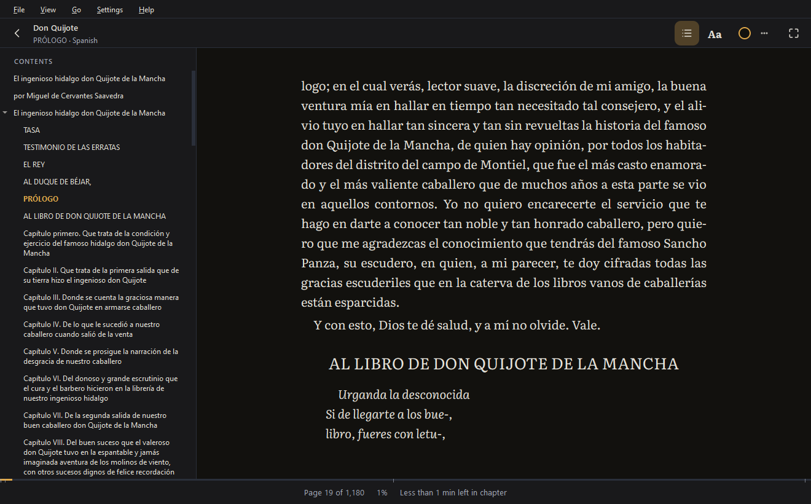
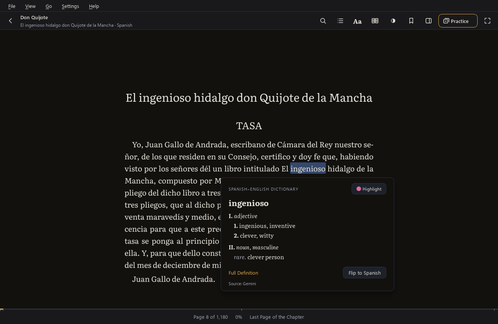
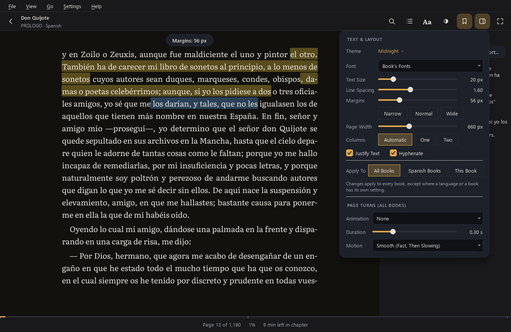
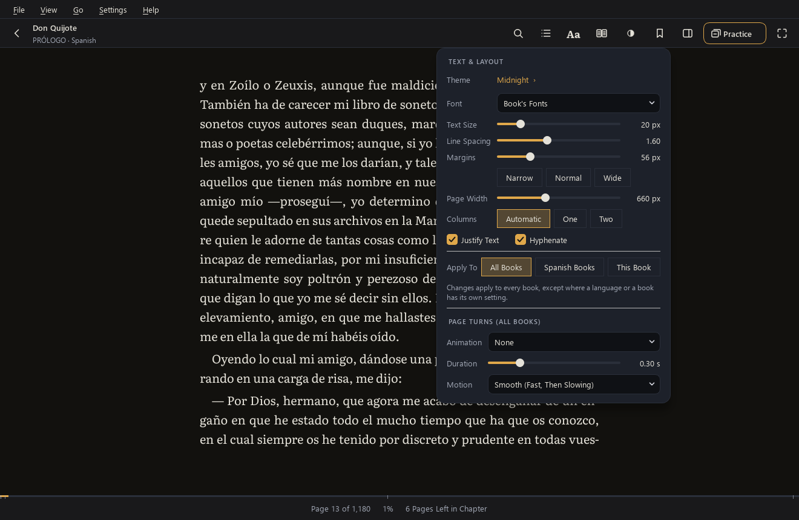
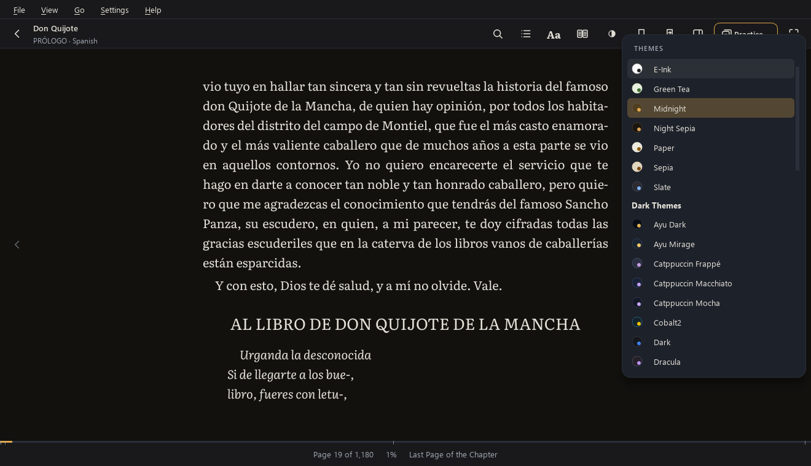

# FreeReader

An e-book reader for DRM-free EPUB books, for Windows (tested) and Linux (experimental), built to make reading in
another language easy: right-click a word or a passage and its English meaning appears next to it. Every word you
look up or highlight is saved, ready to practise as flashcards.



**Status:** early development (phase 4 of 7). The library, reading, themes, text settings, translation, the word
log, flashcard practice, highlights, notes, bookmarks and search work. A Linux release and more formats come next.

## Download

Get the latest version from the [Releases](https://github.com/cincottash/FreeReader/releases) page.

| System | File | Status |
| --- | --- | --- |
| Windows 10 and 11 | `FreeReader.exe` (one file, nothing to install) | Tested |
| Linux | `FreeReader-x86_64.AppImage` | Experimental |

## Library


- **Add Books** takes files or a whole folder, or drop them on the window. The files stay where they are.
- Filter by **Reading**, **Finished**, **Not Started**, by **language**, or by your **collections**: make one with
  **+ New Collection**, then drag books onto it.
- Search by title or author, sort, and switch between covers and a list.
- **Continue Reading** at the bottom reopens the last book where you left off.
- A book whose file was moved shows **File Not Found**; right-click it to **Locate File…**.

<br clear="right">

## Translation



- **Right-click** a word (it's selected for you) or a selection and choose **Translate** (or select and press
  Ctrl+E): a pop-up shows what it means in that sentence, other meanings, its dictionary form ("tenía" → tener),
  a definition in Spanish and the whole sentence in English. **Copy** and **Hear Pronunciation** are in the pop-up.
  The same menu has Look Up in Dictionary, Copy, Search the Web and Search Wikipedia.
- **Explain This Sentence** (right-click, or Ctrl+Shift+E): the sentence in English with short notes on how it
  works (verb forms, pronouns, idioms, old words).
- **Show English Alongside** (View menu, Ctrl+Shift+B): the English of every paragraph on the page in a panel
  beside it, a page at a time; pages you've seen stay translated.
- Prefer the pop-up as soon as you select? Turn on **Settings ▸ Translation ▸ Translate When Text Is Selected**.
- Answers come from **Google's Gemini** (free tier, no card needed), then **LM Studio** on your own computer when
  Gemini can't answer (optional), then what your **Word List** already says, then the **offline dictionaries** and
  the **offline translator**. Every Gemini and LM Studio answer is kept, so looking up the same words again costs
  nothing and works offline. Each one can be switched off in **Settings ▸ Translation**.
- **Set it up once:** get a free key at [aistudio.google.com/apikey](https://aistudio.google.com/apikey), then
  paste it in **Settings ▸ Translation ▸ Translation Settings…**. The key is kept in Windows Credential Manager
  (or the system's key store on Linux), never in a file. **Test** looks up one word to check it works.
- **Offline Only** (for all books, or just the open one) never sends text over the internet.
- **Offline dictionaries** (optional downloads in the translation settings) answer single words at once, with no
  internet:
  - **Spanish → English** (31 MB): 120,000 words from [Wiktionary](https://en.wiktionary.org) (CC BY-SA 4.0),
    with verb forms ("tenía" → tener). [Release](https://github.com/cincottash/FreeReader/releases/tag/dictionary-es-en-1).
  - **English definitions** (11 MB), for English books: 160,000 words and names from
    [Open English WordNet](https://github.com/globalwordnet/english-wordnet) (CC BY 4.0), with their forms
    ("ran" → run, "studies" → study). [Release](https://github.com/cincottash/FreeReader/releases/tag/dictionary-en-1).
- **Offline translator** (30 MB, optional download in the same place): translates Spanish sentences and pages
  with no internet, in a fraction of a second, when Gemini and LM Studio can't. It's
  [Bergamot](https://github.com/browsermt/bergamot-translator), the engine Firefox translates with, and Mozilla's
  Spanish → English model (both MPL 2.0). Its English is plainer than Gemini's and weaker on old Spanish, so it isn't
  kept: Gemini's answer replaces it once online. [Release](https://github.com/cincottash/FreeReader/releases/tag/offline-translator-1).
- **Hear Pronunciation** uses the computer's own voices. Windows: add a voice for the book's language (free) in
  Settings ▸ Time & Language ▸ Speech; the pop-up says when one is missing. Linux: speech-dispatcher with
  espeak-ng.

## Practice


- **Practice Words** (Ctrl+P, or the Practice button in the library) turns the words you looked up or
  highlighted into flashcards (a highlighted word is never looked up for this: the offline dictionary fills in its
  meaning, or its card has a **Look Up Meaning** button), scheduled with FSRS (the spaced-repetition method Anki uses): each card comes back just before you
  would forget it.
- Choose the directions: Spanish → English, English → Spanish, Definition → Word, or the book's sentence with a
  gap. Flip the card, or type the answer (missing accents are accepted but pointed out).
- **Word List:** every word with its meaning, book and page. Search, change a meaning, star, **Show in Book**,
  and **Export…** a file Anki can import.
- **Statistics** (Go menu): time read today and this week, days in a row, books finished, words, cards learned,
  reviews and how many you remembered, with charts of the last 30 days and the time spent on each book.

## Highlights, notes and search



- **Highlight** in pink, orange, yellow or blue from the dots at the top of the right-click menu. Highlights cover
  whole words; right-click one to change its color, add a note or remove it (its own color again removes it too).
- **Bookmark This Page** (Ctrl+D, or the bookmark button).
- **Notebook** (Ctrl+Shift+N): the book's highlights, notes and bookmarks in reading order, filtered by kind or
  color. Click one to go there; **Export…** saves them as Markdown, or as JSON for other tools.
- **Search This Book** (Ctrl+F): every place a word or phrase appears, with its page. Accents and capitals don't
  matter unless you ask ("razon" finds "razón").
- **Search All Books** (Ctrl+Shift+F, or **Search Inside Books** in the library): the same in the text of every
  book in the library, book by book; click a result to open the book there.

FreeReader never changes your book files: highlights and notes live in its own database.

## Reading

- **Turn pages:** arrow keys, Page Up and Page Down, Space, the mouse wheel, or the arrows at the edges of the page.
- **Contents:** the list button in the header (Ctrl+T). The current chapter is marked.
- **Go to a page or point:** Ctrl+G, then a page number or a percentage such as `45%`. Click the progress bar
  to jump there. **Back to Page …** (or Alt+Left) returns to where you were.
- **Footnotes** open in a small pop-up next to the reference. **Pictures** open full size when clicked.
- **Menus:** File, View, Go, Settings and Help at the top left. Ctrl+K lists every command with a search box.

Page numbers stay the same whatever the text size or the window: one page is 1,800 characters of the book, or
the publisher's own page numbers when the book has them.

## Text and layout



The **Aa** button sets the font (the book's own, the bundled Literata or Atkinson Hyperlegible, or any font on
your computer), text size, line spacing, margins, page width, one or two columns, justification and
hyphenation. **Apply To** decides which books a change is for: all books, all books in that language, or only
this one.

## Themes



43 themes restyle the whole app: FreeReader's reading themes (Midnight, Paper, Sepia, Slate and more) and
popular dark and light editor schemes. Point at a theme to preview it; your last few themes sit as dots in the
header. **Match Operating System** follows Windows' light or dark mode.

FreeReader only opens books without DRM. It never removes or works around DRM.

<details>
<summary>Keyboard shortcuts</summary>

Every shortcut can be changed in **Settings** (Ctrl+,).

| Command | Shortcut |
| --- | --- |
| Show Commands | Ctrl+K, Ctrl+Shift+P, F1 |
| Open Book… | Ctrl+O |
| Add Books… | Ctrl+Shift+O |
| Go to Library | Ctrl+L |
| Show or Hide Contents | Ctrl+T |
| Text and Layout… | Ctrl+Shift+A |
| Choose Theme… | Ctrl+Shift+T |
| Go to Page or Percent… | Ctrl+G |
| Translate Selection | Ctrl+E |
| Search This Book… | Ctrl+F |
| Bookmark This Page | Ctrl+D |
| Show or Hide Notebook | Ctrl+Shift+N |
| Practice Words | Ctrl+P |
| Back | Alt+Left, Backspace |
| Next Chapter / Previous Chapter | Ctrl+Page Down / Ctrl+Page Up |
| Go to Beginning of Book | Ctrl+Home |
| Start / End of Chapter | Home / End |
| Larger Text / Smaller Text / Default Text Size | Ctrl+= / Ctrl+- / Ctrl+0 |
| Full Screen | F11 |
| Copy | Ctrl+C |
| Settings… | Ctrl+, |
| Quit | Ctrl+Q |

</details>

<details>
<summary>Linux (experimental)</summary>

The AppImage is built and started automatically on every change, but it hasn't been used on a real Linux
desktop yet. It runs through X11; on a Wayland desktop it uses XWayland, which most desktops turn on by default.

</details>

<details>
<summary>Command line</summary>

```
FreeReader [book.epub] [--data-folder FOLDER]
FreeReader [book.epub] --screenshot out.png [--page N | --percent P] [--turn N] [--size WxH]
           [--columns one|two|auto] [--text-size PERCENT] [--font FAMILY] [--theme KEY]
           [--contents] [--palette] [--appearance] [--theme-list] [--add-books FOLDER] [--list-view]
FreeReader --check-translation result.txt
```

`--data-folder` uses that folder for this run only. `--screenshot` draws the window off-screen to a picture and
exits; it never shows a window or a dialog, and it uses a throwaway library. `--check-translation` looks up one
word with Gemini and the saved key (one of the day's free lookups), writes the answer to the file and exits.

</details>

<details>
<summary>Building from source</summary>

C++20, Qt 6 (Widgets, Svg, Sql, Concurrent, Network; TextToSpeech when available) and zlib, built with CMake.

- **Windows:** MSYS2 UCRT64 with `mingw-w64-ucrt-x86_64-{gcc,cmake,ninja,qt6-base,qt6-svg}` (add `qt6-speech` for
  pronunciation). For the single-file
  exe, add `qt6-static` and configure with `-DSTATIC_BUILD=ON -DCMAKE_PREFIX_PATH=<msys2>/ucrt64/qt6-static`.
- **Linux:** Qt 6.5 or newer, zlib, CMake and Ninja.

```
cmake -S . -B build -G Ninja -DCMAKE_BUILD_TYPE=Release
cmake --build build
```

</details>

<details>
<summary>How it works</summary>

- `src/core/format`: format plug-ins turn a file into a book (metadata, contents, chapters, resources). EPUB 2
  and 3 first.
- `src/core/html`, `src/core/css`: a forgiving HTML parser and the CSS subset books use, with the cascade.
- `src/core/layout`: FreeReader's own layout engine. Each chapter becomes a flow of paragraphs, images and
  tables with stable character positions, laid out into pages on background threads (with hyphenation by
  Liang's algorithm) and drawn with QPainter. No browser engine is used.
- `src/core/position`: positions as EPUB CFI, which keep working when the text size or window changes.
- `src/core/services`: the book engine (opening, layout cache), the library database (SQLite), adding books, the
  word log, highlights and notes, book search and the system key store.
- `src/core/translate`: translation providers (Gemini, LM Studio, the Word List, the offline dictionaries, the
  offline translator, which runs Bergamot as a separate program) and the service that
  tries them in order and caches answers.
- `src/core/practice`: the FSRS scheduler and typed-answer checking for flashcards.
- `src/app`: the windows.

</details>

<details>
<summary>Credits</summary>

- Fonts: [Literata](https://github.com/googlefonts/literata) (The Literata Project Authors) and
  [Atkinson Hyperlegible](https://www.brailleinstitute.org/freefont/) (Braille Institute of America), both under
  the SIL Open Font License (`resources/fonts`).
- Hyphenation patterns from the [hyph-utf8](https://github.com/hyphenation/tex-hyphen) project for Spanish,
  English, French, German, Italian and Portuguese, each under its own free license (`resources/hyphenation`).
- The dark and light themes are adjusted from popular editor color schemes (Nord, Dracula, Solarized, Gruvbox,
  Catppuccin, Rosé Pine, Tokyo Night, Everforest, Kanagawa, Ayu, One, Palenight, Night Owl, Cobalt2,
  Synthwave '84, Tomorrow, Monokai, Zenburn) and keep their authors' names.

</details>

## License

Copyright (C) 2026 cincottash. Licensed under the [GNU General Public License v3.0](LICENSE).
